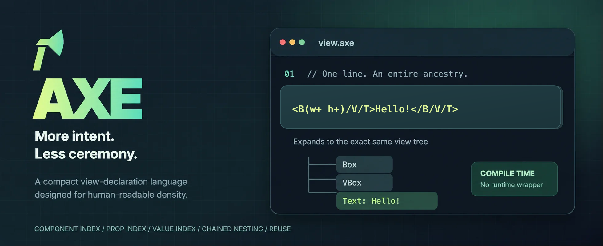
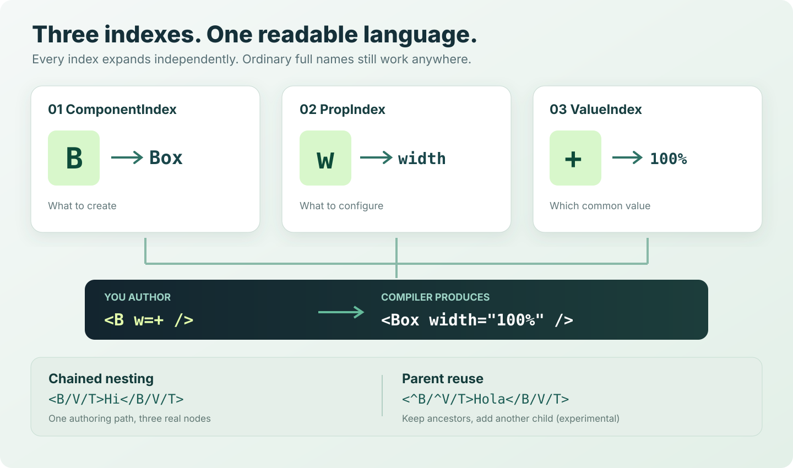
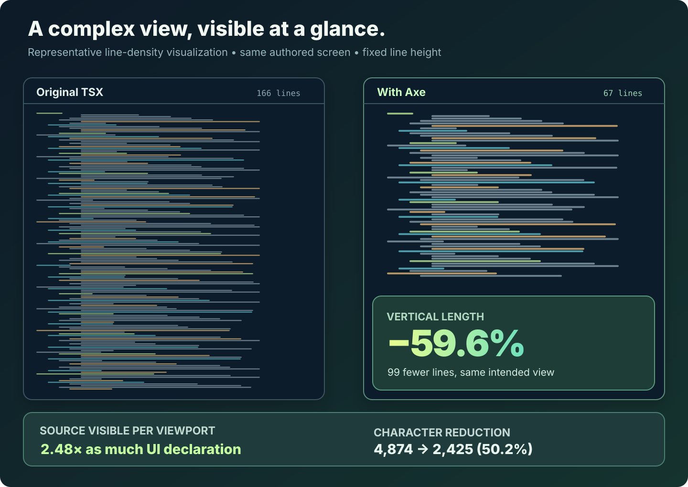

  

# Axe

**More intent on screen. Less markup ceremony.**

> **The code becomes less like reading instructions and more like recognizing shapes.**

**AXE is designed for fluency, not just brevity.** As familiar component and property aliases become recognizable patterns, attention can shift from decoding repetitive framework syntax to reading the application's actual meaning.

Axe is an experimental, compile-time syntax for XML-like view declarations. It keeps familiar tags, nesting, text, expressions, and named properties, but removes recurring *spelling* and *single-child nesting* overhead. Its goal is **readable density**, not maximum compression.

> **Status: design reference, not an implemented compiler.** The examples document syntax we explored; the exact grammar, especially `^` reuse across scopes, still needs implementation and verification. Ordinary JSX/TSX parsers do not accept Axe's chain and implicit indexed-value syntax unchanged.

## Compress the framework's vocabulary. Preserve the developer's intent.

**AXE shortens the predictable parts of code so the meaningful parts stand out.** Component and property names are familiar, repeated framework vocabulary. The handler names, labels, expressions, and content tell you what *this particular interface* does. Those stay readable and intact.

~~~jsx
// Conventional markup
<Button onClick={onSaveForm}>Save</Button>

// AXE — same button, same handler, same label
<Bt(oC={onSaveForm})>Save</Bt>
~~~

With `Bt: Button` in **ComponentIndex** and `oC: onClick` in **PropIndex**, the shorthand expands back to the same intent. **`onSaveForm` is not abbreviated. `Save` is not abbreviated.** You can tell exactly what action the user will trigger, even when the framework plumbing is shortened.

AXE is **not** trying to compress your application's meaning. It increases the proportion of meaningful information on screen by removing repetitive syntax around it. The full `Button` and `onClick` spellings remain available whenever they read better.

> **Shorten the predictable. Preserve the particular.**

### From decoding syntax to recognizing shapes

At first, a reader may mentally translate `Bt` into `Button` and `oC` into `onClick`. With a consistent, learned index vocabulary, these can become recognizable visual patterns rather than phrases to expand consciously. Then the eyes can land on what is specific to this view: `onSaveForm` and `Save`.

This is AXE's **design hypothesis**, not a measured speed or comprehension claim. Familiar aliases, predictable structure, optional full names, and editor expansion should help people build fluency without hiding meaning. The aim is **faster recognition of intent**, not maximum abbreviation.

See [the fluency rationale and related work](docs/DESIGN.md#fluency-from-decoding-syntax-to-recognizing-shapes).

## The idea in one glance

~~~tsx
// Familiar JSX
<Box width="100%" height="100%">
  <VBox>
    <Text color="blue">Hello there!</Text>
  </VBox>
</Box>

// Axe: same intended element tree
<B(w+ h+)/V/T(c="blue")>Hello there!</B/V/T>
~~~

The vocabulary is optional and shared. You can always write `<Box width="100%">` instead of an alias, and use `=` only when it clarifies an otherwise ambiguous token boundary.

  

## Five complementary ideas

| Feature | Example | What it removes |
| :-- | :-- | :-- |
| **ComponentIndex** | `<B>` → `<Box>` | Repeated long component names |
| **PropIndex** | `w` → `width` | Repeated long attribute names |
| **ValueIndex** | `w+` → `width="100%"` (`w=+` if needed) | Repeated common literal values |
| **Chained elements** | `<B/V/T>Hi</B/V/T>` | Vertical single-child wrappers |
| **Path reuse** (experimental) | `<^B/^V/T>Hola</B/V/T>` | Redeclaring an existing ancestor |

The first three are **independent indexes** that can live in one repository-wide definition file, be imported from a package, or eventually use an industry-standard vocabulary. Indexes expand at compile time; the runtime components remain unchanged.

~~~xml
<!-- Illustrative central index syntax; not yet a parser format -->
<ComponentIndex>
  B: Box
  V: VBox
  T: Text
</ComponentIndex>
<PropIndex>
  w: width
  h: height
  c: color
</PropIndex>
<ValueIndex>
  +: "100%"
  $: "start"
  .: "end"
</ValueIndex>
~~~

**The default is `w+`, not `w=+`.** Indexed values can follow a property token directly: `w+` → `width="100%"`, `h+` → `height="100%"`, and even alphabetic tokens such as `gmd` → `gap="medium"`. `w=+` remains a valid **optional explicit separator** when you need to specify where the property token ends and the value token begins. The character `=` is reserved syntax and cannot be part of any alias name. Literal `w="+"` and expression `w={someWidth}` keep their usual meanings.

**Ambiguity is diagnosed where an attribute is used, in its lexical index scope and on its actual element—not by globally banning aliases.** For example, if `w` maps to `width`, `w+` maps to `max_width`, and `+` maps to `"100%"`, `w+` may have multiple valid readings on a given element. Write `w=+` for `width="100%"` or `w+=+` for `max_width="100%"`. Likewise, if `x` is an existing native property and an alias for `extend` on the same element, using `x` is ambiguous: write `extend` there instead. See the [complete resolution rules](docs/SYNTAX.md#14-resolving-aliases-and-ambiguity-at-the-use-site).

## The new kind of nesting

Single-child chains stay explicit while moving *left to right*:

~~~tsx
<B(w+ h+)/V/T(c="blue")>Hello!</B/V/T>
~~~

The inner `T` receives the text; each ancestor may have its own `(...)` attributes. Ordinary nested JSX is still available for branching layouts.

The next idea is **reuse**, not a closing-tag replacement:

~~~tsx
<B(w+ h+)/V/T>Hello!</B/V/T>
<^B/V/T>Hola!</B/V/T>       // Same B, NEW V
<^B/^V/T>Bonjour!</B/V/T>  // Same B, same most-recent V
~~~

The `^` prefix is an **experimental reference** to an existing element in a constrained authoring scope; it does **not** mean “pop the stack.” Its precise scoping, ambiguity, and ordering rules are an open design item. See [the syntax reference](docs/SYNTAX.md).

## See the difference

  

An exploratory, formatting-specific screen comparison went from **166 to 67 lines** — **99 lines eliminated, 59.6% less vertical source, or 2.48× as much view declaration visible at a fixed line height**. The same comparison went from **4,874 to 2,425 characters** (about **50.2% smaller**). These numbers describe a *particular authored example*, not a guaranteed reduction. Index files and compiler machinery are not part of that view-only count. To avoid copying private app source into this public repository, the runnable-looking examples here use invented UI and identifiers.

Read the [fully worked, original profile-editor example](examples/profile-editor.original.tsx.txt) beside the [Axe rendering](examples/profile-editor.axe), or visit the [annotated examples](docs/EXAMPLES.md).

## What Axe does **not** do

- It does **not** rename your variables, handlers, or data models.
- It does **not** introduce a `repeat` prop, pipe-separated siblings, or a template loop system. Use the host language's maps/loops.
- It does **not** make indentation or line breaks determine ordinary nesting.
- It does **not** require aliases, or force every prop on one line.
- It does **not** pretend that reducing characters always increases readability.

Axe preserves verbose, well-named markup as an escape hatch *by design*.

## Existing layout declarations can participate

Estragon's existing `layout const` declarations already define reusable named regions, defaults, and grid matrices. Axe indexes can expand inside those declarations **before** Estragon interprets the layout. The grid's source line boundaries intentionally define matrix rows; this is distinct from Axe's whitespace-insensitive element-chain idea.

~~~gogo
layout const <App w+ h+ gap="8px" columns={["160px", "1fr"]}>
  <Header /> <Header />
  <Side /> <Body />
  <Side /> <Footer />
</App>
~~~

This is a **proposed integration**, not something currently accepted by Estragon. See [Estragon's actual layout-declaration contract](https://github.com/papercraftgames/Estragon/blob/main/docs/LAYOUT_DECLARATIONS.md).

## Explore the design

- **[Syntax and semantics](docs/SYNTAX.md)** — indexes, chaining, `^` reuse, errors, source order, and host-language boundaries.
- **[Annotated examples](docs/EXAMPLES.md)** — simple branches, shared parents, independent layouts, a form, and Estragon integration.
- **[Design decisions and open questions](docs/DESIGN.md)** — what we tried, rejected, and still need to decide.
- **[Example index file](examples/shared-indexes.axe)** — proposed repo-wide authoring vocabulary.
- **[Measurements](docs/MEASUREMENTS.md)** — transparent, reproducible before/after counts (plus the exploratory complex-screen benchmark).
- **[Profile editor before](examples/profile-editor.original.tsx.txt) / [after](examples/profile-editor.axe)** — self-contained illustrative view snippets.

### Editor possibilities

Because aliases are static, an IDE could offer hover-to-expand, toggle between shorthand/full names, autocomplete for both, navigation to index definitions, and diagnostics mapped back to the authored source. None of those features needs to dictate how the source is written.

**North star:** *Keep the meaning. Lose the ceremony.*
