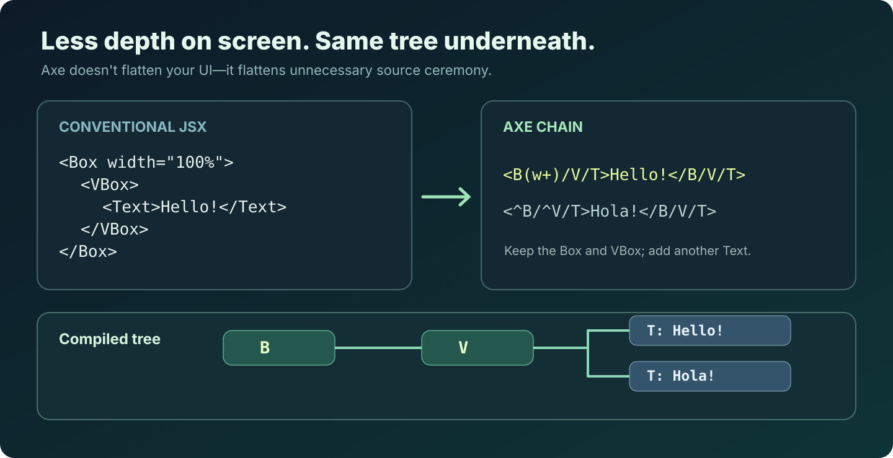

# Axe example gallery

These are original, self-contained illustrative examples of **proposed syntax**. The matching plain JSX is shown where it helps. See [shared indexes](../examples/shared-indexes.axe).

## 0. Preserve the meaning, remove the repetition

~~~jsx
// Ordinary JSX — behavior is onSaveForm, label is Save
<Button onClick={onSaveForm}>Save</Button>

// Axe — those two meaningful details are unchanged
<Bt(oC={onSaveForm})>Save</Bt>
~~~

For this illustration, **ComponentIndex** contains `Bt: Button` and **PropIndex** contains `oC: onClick`. These are framework-vocabulary aliases, not renamings of application data. We deliberately **do not** shorten `onSaveForm` or `Save`: they tell you the control's purpose. Developers are always free to use either full spelling or the indexed spelling, even within one view.

This is the design goal behind *readable density*: **less redundant markup, more visible intent**.

## 1. Tiny: three indexes together

~~~jsx
<B w+ h+>
  <T c="blue">Hello!</T>
</B>
~~~

Expands into ordinary component and property names:

~~~jsx
<Box width="100%" height="100%">
  <Text color="blue">Hello!</Text>
</Box>
~~~

Try writing `<B width="100%" h+>` instead—mixing shorthand and full names is intentional. Here, `w+` is the **preferred** compact spelling; `w=+` remains an optional explicit spelling.

## 2. A path is still a tree

~~~jsx
<B(w+ h+)/V(gmd)/T(c="blue")>Hello!</B/V/T>
~~~

means:

~~~jsx
<Box width="100%" height="100%">
  <VBox gap="medium">
    <Text color="blue">Hello!</Text>
  </VBox>
</Box>
~~~

No indentation is required for *the parser* to understand the chain, but indentation in conventional nested markup is still useful for human eyes.

## 2a. Delimiters and local ambiguity

`=` is available when two independent indexes create multiple ways to split an attribute. It is **not required** for the typical case, and `=` itself is never legal inside an alias name.

~~~xml
<PropIndex>
  w: width
  w+: max_width
  x: extend
</PropIndex>
<ValueIndex>
  +: "100%"
</ValueIndex>
~~~

~~~jsx
<B w+ />                     // Compact: permitted if only one reading is valid here
<B w=+ />                    // Explicit: width="100%"
<B w+=+ />                   // Explicit: max_width="100%"
<Positioned extend={true} /> // Full name when 'x' collides with native x
~~~

If both the bare `w+` property and the split `w` + `+` are legal for a particular element, `<B w+ />` must fail **on that attribute**, suggesting the explicit boundary. Likewise, if a `Positioned` node has native `x`, the `x: extend` alias conflicts **there**: `<Positioned x={10} />` is ambiguous, not silently treated as native `x`. Other element types can still use `x` normally if they have no colliding native property. Defining the aliases in a shared file is not itself an error.

This is a design contract; exact host-specific candidate/type rules remain to be implemented.

## 3. Declare once; add children later

~~~jsx
<B(w+ h+)/V/T>Hello!</B/V/T>
<^B/V/T>Hola!</B/V/T>
~~~

Creates two separate `VBox` nodes under one `Box`:

~~~jsx
<Box width="100%" height="100%">
  <VBox><Text>Hello!</Text></VBox>
  <VBox><Text>Hola!</Text></VBox>
</Box>
~~~

With `<^B/^V/T>` instead, the second Text becomes a child of the **same** VBox. A caret on one segment must not silently imply a caret on its descendants.

These `^` examples illustrate intended shape, pending exact scope-resolution rules.

## 4. Distinct siblings, shared footer

~~~jsx
<Ft(bg=surface)/Rw(d=row ai=center jc=end g=md)/Btn(
  variant="quiet" disabled={!dirty} onP={reset}
)>Reset</Ft/Rw/Btn>

<^Ft/^Rw/Btn(
  variant="primary" disabled={!dirty} onP={save}
)>Save</Ft/Rw/Btn>
~~~

The existing `Footer` and `Row` keep their original properties. Only the second Button is new.

## 5. Normal host expressions remain

~~~jsx
<C(t="Looking For")/Row(g=md)>
  {options.map(option => (
    <Pill key={option.id} selected={selected.has(option.id)}
      onP={() => select(option.id)}>
      {option.label}
    </Pill>
  ))}
</C/Row>
~~~

Axe is **not** an alternative iteration or templating language. Dynamic values and callbacks stay where the host language expects them.

## 6. Big, mostly hand-authored form

The worked [profile editor in conventional TSX](../examples/profile-editor.original.tsx.txt) and [Axe version](../examples/profile-editor.axe) demonstrate manually authored inputs, a different selector, a pair of toggles, and two footer actions. The names are invented for documentation; this is not a copy of a private product screen.

  

## 7. Reusing an Estragon layout suite

Estragon's real layout declarations use line-based matrices of named regions; they are not merely a CSS grid shorthand. The following demonstrates how Axe aliases **could** be accepted by a future integration:

~~~gogo
layout const <Side gap="8px">
  <Top /> <Top /> <Top />
  <BottomLeft /> <BottomMiddle /> <BottomRight />
</Side>

layout const <App w+ h+ columns={["160px", "1fr"]}>
  <Header /> <Header />
  <Side /> <Body />
  <Side /> <Footer />
</App>
~~~

Then populate the already-defined regions:

~~~jsx
<App>
  <Header><T>Dashboard</T></Header>
  <Side><T>Navigation</T></Side>
  <Body><T>Welcome!</T></Body>
</App>
~~~

With a shared component index, even `App`, `Header`, `Side` and `Body` may be abbreviated. The important distinction: layouts themselves own structure/defaults, while Axe indexes only make authored spelling shorter. Check Estragon's [actual documentation](https://github.com/papercraftgames/Estragon/blob/main/docs/LAYOUT_DECLARATIONS.md) before treating an example as runnable GGX.

## 8. What not to abbreviate

~~~jsx
// Good: prominent unique values remain visible.
<Panel t="Deleting your account">
  <WarningText>This action cannot be undone.</WarningText>
</Panel>

// Poor: index every unique sentence and hide the actual meaning.
// 
<W v=R />

~~~

The goal is **readable density**, never the highest possible reduction percentage.
