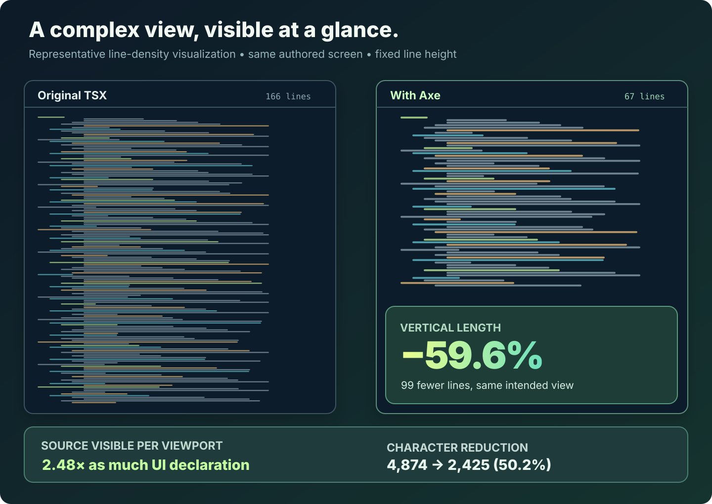

# Measurements: vertical readability, not code golf

Axe is designed to display **more meaningful UI declaration on a screen**. Character count is useful, but line count and visual legibility matter more.

All numbers below are *source-formatting comparisons*. The compiler does not exist yet, so these are not compiled-output parity tests.

## A complex mobile profile editor (exploratory benchmark)

This comes from the private source we examined while designing Axe. We intentionally **do not publish that app source** in this public repo.

| Measured region | Original TSX | Axe design rewrite | Change |
| --- | ---: | ---: | ---: |
| Lines | 166 | 67 | **99 fewer / 59.6% shorter** |
| Characters, including whitespace | 4,874 | 2,425 | **2,449 fewer / 50.2% smaller** |
| Characters, excluding whitespace | 2,731 | 1,738 | 993 fewer / 36.4% smaller |

At a fixed font, size, and line height, the concise authoring form can show about **2.48× as much source** in the same viewport. This is a property of the compared line counts, *not* a general runtime/UI performance claim.

The syntax uses compile-time indexes, chained paths, and experimental caret ancestor reuse. Values/aliases are all resolved *outside* the view; indexes are not counted in the local source.

## Public reproducible example

We also provide a deliberately invented profile editor in this repo. No private product source is required.

- [Conventional original](../examples/profile-editor.original.tsx.txt)
- [Axe design rewrite](../examples/profile-editor.axe)
- [Shared index definitions](../examples/shared-indexes.axe)

Run with Node (no dependencies):

~~~sh
node tools/measure-examples.mjs
~~~

The script counts only the view text from the first `return (` to its matching example-ending `);` line, excluding explanatory comments:

| Region | Plain TSX | Axe | Difference |
| --- | ---: | ---: | ---: |
| Lines | 68 | 25 | **43 fewer / 63.2% shorter** |
| Characters | 1,432 | 808 | **624 fewer / 43.6% smaller** |
| Non-whitespace characters | 844 | 652 | 192 fewer / 22.7% smaller |

The examples are intentionally not maximally packed. Property expressions are allowed to remain multiline when doing so helps reading.

## Fairness and limitations

This is *not* a comparison between two running compilers. It does not include the central index definitions or parser/tooling costs. Different code formatters or display widths may alter the apparent savings. A mixed screen with many long expressions may benefit less than a layout dominated by wrappers and repeated property names.

The source code should remain understandable even when an editor doesn't offer hover expansion or shorthand toggling.

**The goal is not a particular percentage. The goal is to stop scrolling past the structure you are trying to understand.**
